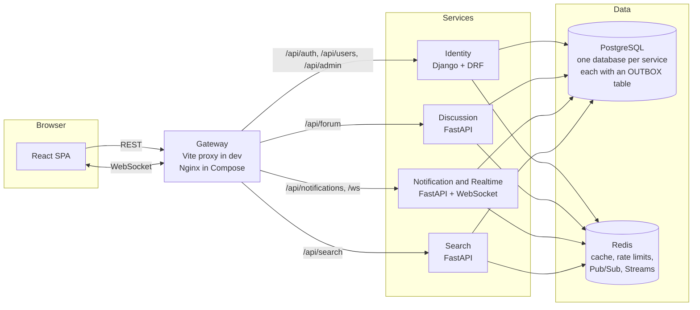

# High-Level Design (HLD): Advanced Real-Time Discussion Forum

## 1. Purpose

Members, moderators, and admins use a web forum to create threads, reply in nested comments, like content, search threads and comments, report problems, and receive live updates and notifications.

The backend enforces every permission. The React UI shows role-appropriate controls, but it is never the security boundary.

---

## 2. Scope

| Group | Items |
|---|---|
| **Official assignment** | Registration and login (JWT); password hashing; unique `username` for mentions; profile updates (name, avatar URL, bio); password reset with a one-time recovery code; Admin / Moderator / Member roles enforced by the backend; threads with title, description, and tags; paginated list and detail; edit and delete; keyword search over threads (title, tags, content) and comments; nested comments; one like per user on threads and comments; live WebSocket updates (new threads, comments, like counts); notifications for replies and `@mentions`; three role dashboards |
| **Moderation** | Members can report threads and comments; moderators review a report queue; moderators and admins can edit or delete any thread or comment; admins can disable and re-enable accounts |
| **Reliability** | Transactional outbox in every service that publishes events, with at-least-once delivery and idempotent consumers. No event is lost when Redis is down or a process crashes after a commit. |
| **Chosen enhancements** | Redis caching with invalidation; Redis distributed rate limiting; persistent activity log fed by events; Redis Pub/Sub (live delivery) and Streams (durable events for notifications, search, and audit); unlike; semantic search as a second pass (Phase 2); Docker Compose |
| **Out of initial scope** | Email verification; email-based password reset (future scope); refresh-token rotation UI; dark mode; avatar file upload, storage, or image processing; "who liked" list; Elasticsearch; Kubernetes; RabbitMQ; tamper-evident audit |

---

## 3. Architecture

### 3.1 Logical view

### 3.2 Gateway

The gateway is the single address the browser talks to. It forwards each request to the right service by URL path. This avoids four origins, per-service CORS setup, and multiple WebSocket URLs.

It is infrastructure, not a business service: routing and TLS only, never business rules. It does **not** do per-user rate limiting, because it sees IPs, not verified users.

| Environment | Gateway | Reason |
|---|---|---|
| Local development (Phase 1) | Vite dev-server proxy | One config line, no extra container |
| Compose and deployment (Phase 2) | Nginx | TLS, WebSocket upgrade, size limits, timeouts |

### 3.3 Services

| Service | Stack | Owns | Responsibility |
|---|---|---|---|
| Identity | Django, DRF, JWT | `identity_db` | Registration, login, refresh, profile, username, avatar URL, roles, account status (active or disabled), password reset with recovery codes, Django Admin, activity log (written from its own actions and from `activity.recorded` events) |
| Discussion | FastAPI, SQLAlchemy 2.x, Alembic | `discussion_db` | Threads, tags, nested comments, likes, reports, pagination, ownership and moderation checks, event publishing through the outbox |
| Notification and Realtime | FastAPI, SQLAlchemy 2.x, Alembic, WebSockets | `notification_db` | WebSocket connections, live fan-out, notifications, read/unread state, mention parsing, event publishing through the outbox |
| Search | FastAPI, SQLAlchemy 2.x, Alembic | `search_db` | Keyword search over threads and comments (ILIKE), later semantic search, index sync from events |
| Frontend | React, Vite, React Router, TanStack Query | none | Pages, dashboards, WebSocket hook, role-aware UI |

**Why four services:** each owns one domain area and one database, so boundaries are explicit and we learn the real costs of distribution (network calls, partial failure, eventual consistency). The trade-off is more code and more to run locally.

### 3.4 Event delivery

Every service that publishes events writes them to its own `OUTBOX` table in the same database transaction as the change. A relay task then reads unpublished rows in order and delivers each one to Redis: to a Stream for durable consumers, to Pub/Sub for live browser updates, or to both. The relay marks a row as published only after delivery succeeds.

This gives three guarantees. An event exists if and only if its change committed, so a crash or Redis outage cannot leave a saved reply without its notification or search entry. Delivery is at least once, so a relay restart can send an event twice. Every consumer records the IDs of events it has processed and ignores repeats, so duplicates have no effect. A Redis outage delays events but never loses them.

The cost is a short delay between commit and delivery, usually well under one second, and one extra table in each publishing service.

Moderation and admin actions are recorded as `activity.recorded` events. Identity consumes them and writes the activity log, so Identity remains the only owner of that table.

---

## 4. Data Ownership

**Rule:** a service writes only to its own tables. Other services get data through HTTP APIs or Redis events. No ORM model is shared.

| Data | Owner | Other services see it through |
|---|---|---|
| Users, usernames, roles, account status, profiles, avatar URLs, recovery code hashes | Identity | JWT claims (`sub`, `role`), internal status endpoint, `user.*` events |
| Threads, tags, comments, likes | Discussion | Events; Search keeps its own index |
| Reports and report status | Discussion | Moderator dashboard REST endpoints |
| Notifications | Notification and Realtime | Its own REST endpoints |
| Search documents (threads and comments) | Search | Its own REST endpoints |
| Activity log | Identity | Other services emit `activity.recorded` events; Identity writes the log |
| Outbox entries | Each publishing service | Read only by that service's relay |

Discussion stores `author_id` as a plain UUID with no foreign key, since users live in another database. The same applies to `reporter_id`.

---

## 5. Authorization Model

| Role | Summary |
|---|---|
| Member | Creates threads and comments; edits and deletes own content; likes; reports content; manages own profile, recovery code, and notifications |
| Moderator | Member abilities, plus edits and deletes any thread or comment (including admin-authored); reviews the report queue; reviews moderation activity; cannot change roles or disable accounts |
| Admin | Moderator abilities, plus user management, role changes, disabling and re-enabling accounts, issuing recovery codes for locked-out users, and the full activity log |

Rules across all services:
- The service that owns a resource enforces authorization on every request.
- **Reads and ordinary member writes** trust the role in the JWT. Role changes take effect for these when the access token expires (up to 15 min).
- **Moderation and admin actions** (edit or delete of content not authored by the caller, report review, role changes, disabling) check the user's current role and status against Identity before they run. Discussion and Notification and Realtime call Identity's internal status endpoint and cache the result in Redis for 30 seconds. Identity publishes `user.role_changed` and `user.disabled` events, which clear the cache entry. A demoted moderator loses moderation rights almost immediately, not after 15 minutes.
- **Disabled users** cannot log in or refresh tokens. Their existing access token stops working at the next moderation or admin check, and at the next ordinary write, because writes also check status through the cache.

The full permission matrix is in the LLD.

---

## 6. Security

- Passwords are hashed with bcrypt. Recovery codes are stored as HMAC-SHA256 hashes.
- Identity issues short-lived JWT access tokens (15 minutes) signed with RS256.
- Every service validates the token's signature, issuer, audience, and expiry before using it.
- Secrets and private keys are never committed to source control. They come from environment variables or mounted secret files.
- Member: manages own content. Moderator: moderates other users' content. Admin: manages users and roles.
- Each service enforces permissions for its own operations. The UI and the gateway are not security boundaries.
- Role and status changes take effect promptly. Services cache role and status for at most 30 seconds, clear that cache when a change event arrives, and check current status through Identity before moderation and admin actions. No service trusts a role claim beyond the token's lifetime.
- WebSocket connections are authenticated when they open. Private notifications are sent only to the recipient's user room, and no connection receives another user's notifications.
- Refresh tokens last 7 days, sit in an HttpOnly, Secure, SameSite=Strict cookie, and are revoked on logout, password reset, and reuse.
- Input is validated, and database queries are parameterized. Thread and comment text is plain text, escaped by React.
- Avatar URLs must use `https://`. The server never fetches them.
- Rate limits apply to login, registration, password reset, writes, and search.
- Service-to-service calls use a per-service API key.

---

## 7. Feature Rules

These decisions shape the data model and the LLD.

**Usernames.** Each user picks a unique `username` at registration (3 to 30 characters: letters, digits, and underscores; case-insensitive uniqueness). Usernames can be changed once every 30 days, and the old one is released. Mentions match on username.

**Password reset with recovery codes.** Email-based reset is future scope, so Phase 1 uses recovery codes:
- At registration, Identity generates a recovery code (random, 16 characters, shown in groups) and displays it once. Identity stores only its hash.
- To reset, the user enters username, recovery code, and new password. A valid code sets the password, is replaced by a new code, and the new code is shown once.
- A logged-in user can regenerate their recovery code from the profile page. The old code stops working immediately.
- If a user loses both password and code, an admin can issue a one-time recovery code for that account from the admin dashboard, valid for 24 hours. The admin passes it to the user out of band.
- Reset attempts are rate limited through Redis, and every successful reset is recorded in the activity log.

**Tags.** Members enter up to 5 tags when creating a thread. Tags are lowercased, trimmed, limited to 30 characters, and stored in Discussion. There is no fixed tag list in Phase 1. Admins can remove a tag from all threads if it is abused. Search matches tags as well as thread title and content.

**Search.** Search covers threads and comments:
- Thread search matches title, tags, and description.
- Comment search matches comment body. Each comment hit shows a snippet and links to the comment inside its thread.
- Results are paginated and can be filtered by type (thread or comment).
- The search index is updated from Discussion events. Deleted content is removed from the index.
- Content from disabled users stays in the index and in results, as with any other content.

**Reporting.** Any member can report a thread or comment once, with a reason from a fixed list (spam, harassment, off-topic, other) and an optional note. Reports are stored in Discussion. The moderator queue lists open reports, and a moderator marks each one as resolved or dismissed. Resolving a report can include deleting the content. Every action is recorded in the activity log.

**Account disabling.** Admins can disable an account with a required reason. Disabled users cannot log in, refresh tokens, or write content. Their content stays visible unless an admin or moderator removes it. Re-enabling restores access and is also recorded.

**Deletion.** Threads and comments are soft-deleted. A deleted thread is hidden from lists and removed from the search index. A deleted comment that has replies keeps its place in the tree and shows as "[deleted]", so the replies stay readable. A deleted comment with no replies is hidden entirely. The activity log records every delete.

**Avatars.** A member sets an avatar by entering an image URL on the profile page. The server validates the format and stores the string. It does not fetch the image; the browser loads it directly. Broken URLs show a placeholder. There is no upload, storage, or image processing in Phase 1.

**Nesting depth.** Comments nest up to 6 levels deep. A reply to a comment at depth 6 is attached as a sibling at depth 6 and marked as a continuation of the same branch. The UI shows a "Continue this thread" link in place of deeper nesting.

**Comment pagination.** A thread loads its top-level comments 20 at a time using cursor pagination. Each comment shows up to 3 replies by default, with a "Load more replies" control. Nothing loads the whole tree at once.

**Notifications.** Rules:
- A reply to a thread notifies the thread author.
- A reply to a comment notifies that comment's author.
- A mention notifies the mentioned user.
- Users never get a notification for their own actions, including self-mentions.
- If one action triggers both a reply and a mention for the same user, that user gets one notification, typed as a mention.

---

## 8. Testing and Deployment

**Testing**

| Level | Tools | Focus |
|---|---|---|
| Unit | pytest, Django test runner | Permissions, mention parser, username rules, tag normalization, avatar URL validation, recovery code generation and hashing, cursor encoding, ILIKE escaping, rate limiter, nesting depth |
| API | pytest + httpx, DRF test client | Endpoints, auth, validation, error format, password reset with recovery codes, reports, disabling, search on threads and comments |
| Integration | Docker test services (real PostgreSQL and Redis) | Outbox rollback and replay, relay restart and duplicate handling, consumer deduplication, cache invalidation on role and status events, search index updates, audit writes from events |
| WebSocket | pytest-asyncio | Auth, event filtering, reconnection |

Every milestone ends with passing tests before the commit. Negative tests (403, 409, 429, Redis down, duplicate event, reused recovery code, disabled user, demoted moderator, relay stopped during an outage) are required.

**Deployment**
- Local: Docker Compose with PostgreSQL, Redis (with append-only persistence enabled), the four services and their relay workers, and the frontend behind Nginx.
- `/health` on every service; `.env.example` committed, secrets never.
- Migrations: Django `migrate` for Identity; Alembic at container start for FastAPI services.

---