# Low-Level Design (LLD): Advanced Real-Time Discussion Forum

This document turns the HLD into schemas, endpoints, flows, and diagrams. Where it makes a decision the HLD left open, it says so in the section that makes it.

---

## 1. Conventions

| Topic | Decision |
|---|---|
| Primary keys | `uuid` in every database (UUIDv4). Used in JWT `sub`, URLs, cache keys, and events. |
| Timestamps | `timestamptz`, UTC, ISO 8601 with `Z` suffix |
| Deletion | Threads and comments are soft-deleted with `deleted_at`. Other rows are hard-deleted. Who acted is recorded in `ACTIVITY_LOG`. |
| Password hashing | bcrypt (Django `BCryptSHA256PasswordHasher`). Recovery codes use HMAC-SHA256. |
| Status values | Users have `status` of `active` or `disabled`. Roles are `member`, `moderator`, or `admin`. |
| Pagination | Cursor based everywhere. The cursor is an opaque base64url string encoding `(created_at, id)`. Response shape: `{"items": [...], "next_cursor": "..." or null}`. |
| Page size | Default 20, maximum 50 |
| Error format | Every non-2xx response uses the body in 4.1 |
| Auth | `Authorization: Bearer <access_token>` on protected REST endpoints. WebSocket auth is in 4.7. |
| Events | At-least-once delivery through the transactional outbox (section 2.6). `event_id` is the OUTBOX row ID. Consumers deduplicate on it. |
| Versioning | Path prefix `/api`. No version segment in Phase 1. |
| Service-to-service | `/internal/*` routes require header `X-Service-Key`, one key per calling service |
| Username | 3 to 30 characters, `[A-Za-z0-9_]`. Uniqueness on `username_normalized` (lowercase). Changeable once per 30 days. |
| Tag | Lowercased, trimmed, 1 to 30 characters, `[a-z0-9_-]`, maximum 5 per thread |
| Body limits | Thread title 200 characters. Thread description 10,000. Comment body 5,000. Report note 500. Bio 500. |
| Avatar URL | `https://` only, at most 2,048 characters, stored as text. Never fetched by the server. |

**Example identifiers used in this document**

| Name | Role | UUID |
|---|---|---|
| Ali | member, author of thread 412 | `4c1e8a52-9d3b-4f7a-8e21-6b0c5a7d9e01` |
| Omar | member, author of a top-level comment | `7a2d9f14-3c8e-4b6a-9f10-2d5e8c1b7a02` |
| Sara | member, mentioned in a reply | `9e5b3c7a-1f2d-4e8b-a6c4-8d0f2b9e3a03` |
| Hala | moderator | `2b8f6d1e-5a4c-4f9b-b7e2-0c3d9a6f1b04` |
| Yusuf | admin | `1d7a3e9c-8b2f-4a6d-9c5e-4f1b0e8a2c05` |
| Thread | "Best way to handle refresh token rotation?" | `6e4a2c8f-3b1d-4e7a-8f9c-5d2b7a0e4f10` |
| Comment | Omar's top-level comment | `c0a1b2d3-4e5f-4a6b-8c7d-9e0f1a2b3c40` |
| Comment | Ali's reply, mentions Sara | `d1b2c3e4-5f60-4b7c-9d8e-0f1a2b3c4d51` |

---

## 2. Service Catalog

### 2.1 Identity (Django, DRF, RS256 JWT)

Identity is a Django project with several apps. `accounts` holds users, roles, status, and profile. `auth_flow` handles login, refresh, logout, password reset, and recovery codes. `admin_console` provides the admin API and Django Admin. `audit` writes and reads the activity log.

Views call service functions in `services.py`. Views never contain business rules. Each change that other services need is written to Identity's OUTBOX in the same transaction, and the relay delivers it to `stream:identity`. Identity also consumes `activity.recorded` events from `stream:discussion` and writes them to `ACTIVITY_LOG`.

Identity is the only service that signs tokens. It holds the RS256 private key. Other services verify with the public key mounted read-only.

Identity serves `/internal/*` endpoints so other services can look up status, profile snapshots, and usernames. It is the fallback source when a cache entry is missing.

If Redis is down, login and reset still run because Redis is used only for rate limiting. Auth rate limiting fails closed, so requests return 503 rather than running without limits.

### 2.2 Discussion (FastAPI, SQLAlchemy 2.x, Alembic)

Discussion owns threads, tags, comments, likes, and reports.

Every write goes through the same pipeline: JWT verification, rate limit, status check (cached), policy check, service function, and a transaction that also inserts OUTBOX rows. The relay publishes those rows after commit. The pipeline is a set of FastAPI dependencies, so every route runs the steps in the same order.

Module layout: `api/` (routers and Pydantic schemas), `domain/` (policy, depth rules, tag normalization), `repositories/` (SQLAlchemy queries), `events/` (envelope builder and outbox writer), `outbox/` (relay worker), `cache/` (read-through cache and invalidation), `clients/identity.py` (internal HTTP client with a 1-second timeout).

Discussion consumes `stream:identity` for status and role events, and deletes its own `ds:user_status:{id}` cache entries. It writes its events to its OUTBOX, and the relay delivers them to `stream:discussion` for durable consumers and to `ws:*` Pub/Sub channels for live browser updates.

### 2.3 Notification and Realtime (FastAPI, SQLAlchemy 2.x, WebSockets)

This service has two modules in one process. `notify/` is a stream consumer that creates notifications. `realtime/` is the WebSocket gateway that forwards Pub/Sub messages to browsers.

The notify consumer reads `stream:discussion` as consumer group `notify`. For each event it parses mentions and works out reply recipients. In one transaction it inserts the notification rows, the `PROCESSED_EVENT` row, and live OUTBOX rows for `ws:user:{id}`. It acknowledges the stream entry only after that commit.

The realtime gateway subscribes to the Pub/Sub pattern `ws:*`. Each instance keeps its own in-memory registry of sockets. Every instance receives every message, so a client connected to any instance gets every update. The stream consumer group gives each notification to exactly one consumer, so no duplicates are created.

### 2.4 Search (FastAPI, SQLAlchemy 2.x)

Search keeps a denormalized copy of threads and comments in `search_db`. It never calls Discussion or Identity to fill documents. It consumes `stream:discussion` as consumer group `search`, and `stream:identity` for `user.username_changed` events.

### 2.5 Frontend (React, Vite, React Router, TanStack Query)

Server state lives in TanStack Query. One WebSocket hook owns the socket, authenticates, subscribes to the open thread, and writes incoming events into the query cache. Role-aware controls read the role from the decoded access token and hide actions the backend would reject. The backend is the enforcement point.

### 2.6 Transactional outbox and relay

**Problem.** A service that saves a change and then publishes an event can fail between the two steps. The reply is saved but the notification never arrives, or the thread never reaches search.

**Design.** Each publishing service (Identity, Discussion, Notify and Realtime) has an `OUTBOX` table in its own database. Every change inserts its event rows in the same transaction as the change. If the transaction rolls back, neither the change nor the event exists. If it commits, the event is guaranteed to be delivered eventually.

Each event type has a fixed destination, set in code: most events go both to a Redis Stream and to live browsers. Events that only update open browsers, such as `like.changed`, go only to live browsers.

A relay task in each publishing service delivers the rows. Only one relay per service is active at a time, enforced with a Postgres advisory lock, so events leave in creation order.

```
LIVE_ONLY = {"like.changed"}     # these events go only to browsers

every OUTBOX_RELAY_INTERVAL_MS while holding the advisory lock:
    rows = SELECT ... FROM outbox
           WHERE published_at IS NULL
           ORDER BY created_at, id
           LIMIT OUTBOX_BATCH_SIZE
    for row in rows:
        if row.event_type not in LIVE_ONLY:
            XADD stream MAXLEN ~ 100000 envelope=row.payload
        PUBLISH live channel for row.event_type row.payload
        UPDATE outbox SET published_at = now() WHERE id = row.id
    on Redis error: stop batch, log the error, back off
```

The envelope's `event_id` is the OUTBOX row ID. That ID never changes, so retries and relay restarts send the same event ID.

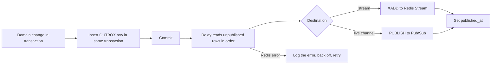

**Delivery guarantee.** At least once. A relay that crashes after `XADD` but before setting `published_at` sends the row again on restart. Consumers handle this, as described below.

**Consumer side.** Each stream consumer processes an entry in one transaction. The transaction inserts a `PROCESSED_EVENT` row for `(event_id, consumer)` and applies the change. If the insert conflicts, the entry was already handled, and the consumer acknowledges it without applying anything. The `XACK` happens after the commit. A consumer that crashes mid-entry leaves it pending. `XAUTOCLAIM` reclaims it after 60 seconds.

**Failure behavior.**

| Failure | Result |
|---|---|
| Redis unavailable | Rows wait in OUTBOX. Requests still succeed. The relay resumes when Redis returns. |
| Postgres unavailable | The write fails with 503 before any event exists. Nothing is lost. |
| Relay process crashes | Unpublished rows remain. The next relay resumes from them. |
| Relay crashes after `XADD`, before marking published | The event is sent again. Consumers ignore the duplicate. |
| Consumer crashes mid-entry | The entry stays pending and is reclaimed. The transaction ensures it is applied once. |
| Consumer falls behind the stream's `MAXLEN` | Missed entries cannot be replayed from the stream. Search uses the rebuild command (section 4.3) to recover. |

**Monitoring.** An alert fires when the oldest unpublished row is more than 60 seconds old. That signal shows a stuck relay or a Redis outage before users notice. Redis errors are written to the service log.

**Retention.** A daily job deletes published rows older than `OUTBOX_RETENTION_DAYS`.

**Identity's audit consumer.** Identity runs `manage.py consume_events` as its own container. It reads `activity.recorded` events from `stream:discussion` in consumer group `audit` and writes them to `ACTIVITY_LOG`, using `PROCESSED_EVENT` in `identity_db` for idempotency.

---

## 3. Schemas

### 3.1 Identity database (`identity_db`)

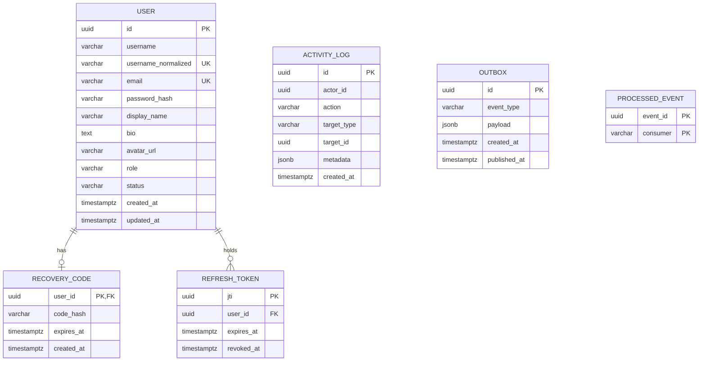

`password_hash` is a bcrypt hash. `role` is `member`, `moderator`, or `admin`. `status` is `active` or `disabled`. Both have check constraints. `username_normalized` and `email` are unique and stored lowercase.

`RECOVERY_CODE` has one row per user, so a new code replaces the old one. `code_hash` is HMAC-SHA256 of the code. `expires_at` is null for self-issued codes and 24 hours after issue for admin-issued codes.

`REFRESH_TOKEN` stores the `jti` only, never the token. A token is valid when its row exists, is unrevoked, and is unexpired.

`ACTIVITY_LOG` has no foreign keys. Suspension reasons, role changes, and username changes are recorded here, with details in `metadata`. The 30-day username rule checks the most recent `username_changed` entry for the user.

### 3.2 Discussion database (`discussion_db`)

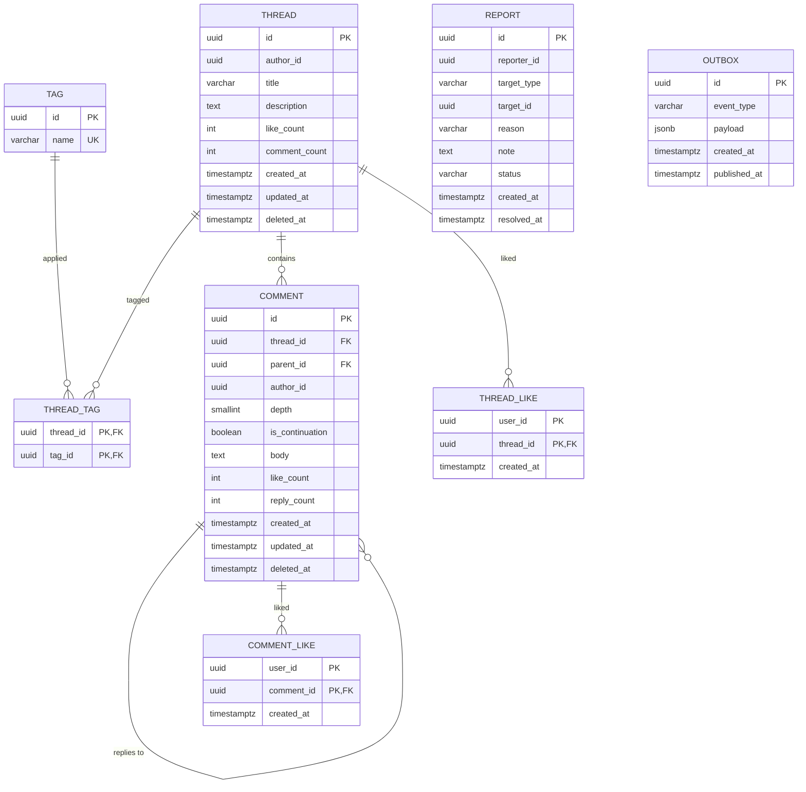

`author_id` is a plain UUID because users live in `identity_db`. `deleted_at` is the only deletion field. Who deleted an item is recorded in `ACTIVITY_LOG`.

`COMMENT.depth` is 1 to 6. `is_continuation` marks a reply attached one level up at depth 6 (rule in 4.4).

`like_count` and `comment_count` change only in the same transaction as the like or comment write. `THREAD_LIKE` and `COMMENT_LIKE` use composite primary keys, so one like per user per item is a database guarantee.

`REPORT.target_id` refers to a thread or a comment, so it has no foreign key. The unique constraint on `(reporter_id, target_type, target_id)` blocks duplicate reports. The resolution itself is recorded in `ACTIVITY_LOG`.

### 3.3 Notification database (`notification_db`)

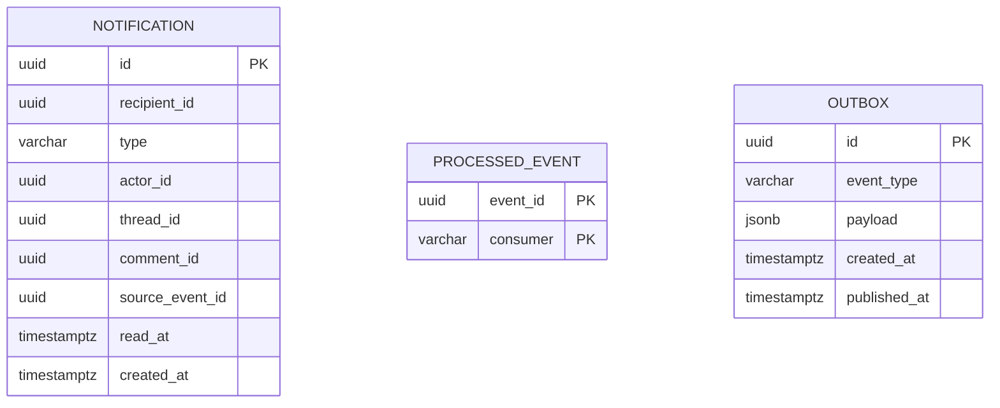

`NOTIFICATION` has a unique constraint on `(recipient_id, source_event_id)`. A redelivered stream entry inserts nothing new. A user who receives both a reply and a mention from one event gets one row. `type` is `reply_thread`, `reply_comment`, or `mention`.

`PROCESSED_EVENT` is the consumer idempotency ledger. Rows older than 14 days are pruned. `OUTBOX` is the relay's queue; its rows are inserted in the same transaction as the notification and the live message.

### 3.4 Search database (`search_db`)

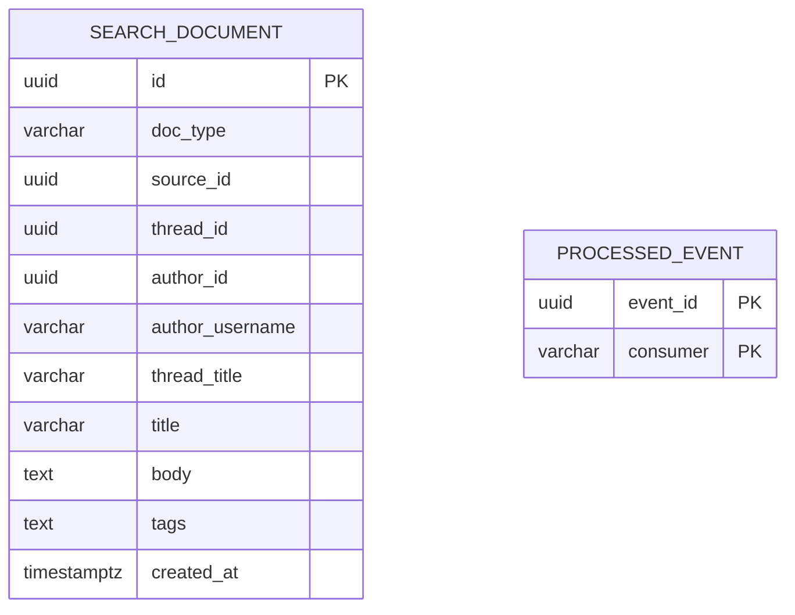

`SEARCH_DOCUMENT` has a unique constraint on `(doc_type, source_id)`, which is the upsert key. Threads and comments share the table.

Every column is filled from event payloads. Search never calls another service to build a document. `author_id` and `author_username` come from `thread.created` and `comment.created`. `title`, `body`, and `tags` come from content events. For comments, `thread_title` is copied from the thread's own document in this database. `author_username` is kept current by `user.username_changed`.

Deleted items are removed from the table. Content from disabled users stays indexed.

### 3.5 Redis keyspace

Redis is shared infrastructure. Each service uses its own key prefix and never writes another service's prefix.

| Key pattern | Type | Owner | TTL | Purpose |
|---|---|---|---|---|
| `id:rl:{scope}:{key}` | counter | Identity | window | Rate limits for auth endpoints |
| `ds:rl:{scope}:{user_id}` | counter | Discussion | window | Rate limits for writes and search |
| `ds:user_status:{user_id}` | JSON | Discussion | 30 s | Cached `{role, status, username}` from Identity |
| `ds:author:{user_id}` | JSON | Discussion | 60 s | Cached author snippet for display |
| `ds:thread:{thread_id}` | JSON | Discussion | 60 s | Thread detail cache |
| `ds:threads:ver` | integer | Discussion | none | Version number used in list cache keys |
| `ds:threads:list:{ver}:{tag}:{cursor}:{limit}` | JSON | Discussion | 60 s | Thread list page cache |
| `rt:user_status:{user_id}` | JSON | Notify and Realtime | 30 s | Cached status for WebSocket auth |
| `stream:discussion` | Stream | Discussion | MAXLEN about 100000 | Domain events |
| `stream:identity` | Stream | Identity | MAXLEN about 50000 | Account and role events |
| `stream:dead` | Stream | Notify, Search | none | Entries that failed five deliveries |
| `ws:global`, `ws:thread:{id}`, `ws:user:{id}` | Pub/Sub | Relays in Discussion and Notify | none | Live fan-out to browsers |

Consumer groups: `notify`, `search`, and `audit` on `stream:discussion`. `discussion-cache` and `realtime-cache` on `stream:identity`. `search` also reads `stream:identity` for username changes.

### 3.6 Event schemas

Each stream entry has one field, `envelope`, holding JSON with the same outer shape. `event_id` is the ID of the OUTBOX row that produced the event, so consumers can deduplicate on it.

```json
{
  "event_id": "7d3f4c2a-9b1e-4f8a-8c3d-2e6a1b9f0d11",
  "type": "comment.created",
  "version": 1,
  "occurred_at": "2026-10-27T09:21:44Z",
  "producer": "discussion",
  "payload": {}
}
```

| Type | Producer | Payload fields | Consumers |
|---|---|---|---|
| `thread.created` | Discussion | `thread_id`, `author_id`, `author_username`, `title`, `description`, `tags`, `created_at` | Search, Notify |
| `thread.updated` | Discussion | `thread_id`, `title`, `description`, `tags`, `updated_at` | Search |
| `thread.deleted` | Discussion | `thread_id`, `actor_id`, `deleted_at` | Search |
| `comment.created` | Discussion | `comment_id`, `thread_id`, `parent_id`, `author_id`, `author_username`, `body`, `depth`, `parent_author_id`, `thread_author_id`, `created_at` | Search, Notify |
| `comment.updated` | Discussion | `comment_id`, `thread_id`, `body`, `updated_at` | Search |
| `comment.deleted` | Discussion | `comment_id`, `thread_id`, `actor_id`, `deleted_at` | Search |
| `like.changed` | Discussion | `target_type`, `target_id`, `thread_id`, `user_id`, `liked`, `like_count` | Realtime only (live channel, no stream entry) |
| `report.created` | Discussion | `report_id`, `target_type`, `target_id`, `reason` | none in Phase 1 |
| `activity.recorded` | Discussion | `actor_id`, `actor_role`, `action`, `target_type`, `target_id`, `metadata`, `occurred_at` | Identity (audit) |
| `user.role_changed` | Identity | `user_id`, `old_role`, `new_role` | Discussion, Realtime (cache) |
| `user.disabled` | Identity | `user_id` | Discussion, Realtime (cache) |
| `user.enabled` | Identity | `user_id` | Discussion, Realtime (cache) |
| `user.username_changed` | Identity | `user_id`, `old_username`, `new_username` | Search |

Example entry for a reply that mentions Sara:

```json
{
  "event_id": "7d3f4c2a-9b1e-4f8a-8c3d-2e6a1b9f0d11",
  "type": "comment.created",
  "version": 1,
  "occurred_at": "2026-10-27T09:21:44Z",
  "producer": "discussion",
  "payload": {
    "comment_id": "d1b2c3e4-5f60-4b7c-9d8e-0f1a2b3c4d51",
    "thread_id": "6e4a2c8f-3b1d-4e7a-8f9c-5d2b7a0e4f10",
    "parent_id": "c0a1b2d3-4e5f-4a6b-8c7d-9e0f1a2b3c40",
    "author_id": "4c1e8a52-9d3b-4f7a-8e21-6b0c5a7d9e01",
    "author_username": "ali_k",
    "body": "Agree with @sara_dev, see the linked doc.",
    "depth": 2,
    "parent_author_id": "7a2d9f14-3c8e-4b6a-9f10-2d5e8c1b7a02",
    "thread_author_id": "4c1e8a52-9d3b-4f7a-8e21-6b0c5a7d9e01",
    "created_at": "2026-10-27T09:21:44Z"
  }
}
```

`like.changed` has no stream entry. The relay publishes it to Pub/Sub only, because it is transient. Clients refetch on reconnect, which corrects any missed count.

---

## 4. API Endpoints

### 4.1 Error responses

```json
{
  "error": {
    "code": "validation_error",
    "message": "Title must be at most 200 characters.",
    "details": { "field": "title" }
  }
}
```

| HTTP | `code` values | When |
|---|---|---|
| 400 | `validation_error`, `invalid_reset_code`, `invalid_cursor` | Body or query fails validation |
| 401 | `unauthenticated`, `invalid_credentials`, `token_expired` | Missing, invalid, or expired token |
| 403 | `forbidden`, `account_disabled`, `insufficient_role`, `not_owner` | Authenticated but not allowed |
| 404 | `not_found` | Missing, or soft-deleted and not visible to the caller |
| 409 | `username_taken`, `email_taken`, `username_change_too_soon`, `duplicate_report` | Conflicts with existing state |
| 422 | `unprocessable` | Valid input that cannot be applied, such as replying to a deleted comment |
| 429 | `rate_limited` | Includes `Retry-After` in seconds |
| 503 | `dependency_unavailable` | Redis or a required service is down and the request cannot be served safely |

Ordinary users get 404 for soft-deleted items. Moderators and admins see them with `"deleted": true`.

### 4.2 Identity endpoints

**Public and self-service**

| Method | Path | Auth | Rate limit | Purpose |
|---|---|---|---|---|
| POST | `/api/auth/register` | none | 5/hour per IP | Create account, return recovery code once |
| POST | `/api/auth/login` | none | 10/min per IP; 5 failures/15 min per email | Issue access token and refresh cookie |
| POST | `/api/auth/refresh` | refresh cookie | 30/min per IP | Rotate refresh token, issue access token |
| POST | `/api/auth/logout` | refresh cookie | none | Revoke current refresh token |
| POST | `/api/auth/password/reset` | none | 5/15 min per username; 20/hour per IP | Reset with recovery code |
| GET | `/api/users/me` | access | none | Current profile and role |
| PATCH | `/api/users/me` | access | 10/min | Update display name, bio, avatar URL |
| POST | `/api/users/me/username` | access | once per 30 days | Change username |
| POST | `/api/users/me/password` | access | 5/15 min | Change password; revokes other sessions |
| POST | `/api/users/me/recovery-code` | access | 5/hour | Regenerate recovery code; old one stops working |
| GET | `/api/users/{username}` | none | none | Public profile |

**Admin**

| Method | Path | Role | Purpose |
|---|---|---|---|
| GET | `/api/admin/users?query=&role=&status=&cursor=` | admin | List and search users |
| PATCH | `/api/admin/users/{id}/role` | admin | Change role |
| POST | `/api/admin/users/{id}/disable` | admin | Disable with reason |
| POST | `/api/admin/users/{id}/enable` | admin | Re-enable |
| POST | `/api/admin/users/{id}/recovery-code` | admin | Issue a 24-hour one-time code |
| GET | `/api/admin/activity-log?actor_id=&action=&target_type=&cursor=` | admin (all); moderator (forum actions only) | Activity log |

**Internal (service key)**

| Method | Path | Caller | Purpose |
|---|---|---|---|
| GET | `/internal/users/{id}/status` | Discussion, Notify and Realtime | Returns `{id, username, role, status}` |
| POST | `/internal/users/batch` | Discussion | Body `{"ids": [...]}`, returns public snippets |
| POST | `/internal/users/resolve` | Notify | Body `{"usernames": [...]}`, returns matching `{id, username}` |

Examples follow. IDs are the example UUIDs from section 1.

Register:

```json
{
  "username": "ali_k",
  "email": "ali@example.com",
  "password": "correct-horse-battery-9",
  "display_name": "Ali Khan"
}
```

Response, 201:

```json
{
  "user": {
    "id": "4c1e8a52-9d3b-4f7a-8e21-6b0c5a7d9e01",
    "username": "ali_k",
    "display_name": "Ali Khan",
    "role": "member",
    "status": "active",
    "avatar_url": null,
    "bio": ""
  },
  "recovery_code": "K7QF-3MZP-WX2A-9HNT",
  "recovery_code_notice": "Shown once. Store it somewhere safe."
}
```

Login sets the refresh cookie (`HttpOnly; Secure; SameSite=Strict; Path=/api/auth`) and returns the access token in the body:

```json
{ "email": "ali@example.com", "password": "correct-horse-battery-9" }
```

Response, 200:

```json
{
  "access_token": "eyJhbGciOiJSUzI1NiIs...",
  "token_type": "Bearer",
  "expires_in": 900
}
```

Password reset:

```json
{
  "username": "ali_k",
  "recovery_code": "K7QF-3MZP-WX2A-9HNT",
  "new_password": "a-new-long-passphrase-42"
}
```

Response, 200:

```json
{
  "message": "Password updated. All sessions were signed out.",
  "recovery_code": "R2TM-8KLD-QJ4E-6PVC",
  "recovery_code_notice": "Your previous code no longer works. Store this new one."
}
```

Admin disables a user:

```json
{ "reason": "Repeated harassment after two warnings." }
```

Response, 200:

```json
{
  "id": "9e5b3c7a-1f2d-4e8b-a6c4-8d0f2b9e3a03",
  "status": "disabled",
  "updated_at": "2026-10-27T10:02:11Z"
}
```

Access token claims:

```json
{
  "sub": "4c1e8a52-9d3b-4f7a-8e21-6b0c5a7d9e01",
  "username": "ali_k",
  "role": "member",
  "iss": "identity",
  "aud": "forum",
  "iat": 1793100000,
  "exp": 1793100900,
  "jti": "1b0e6e0e-2d7c-4f3e-9d43-1c7a2f9a8b10"
}
```

### 4.3 Discussion endpoints

**Threads**

| Method | Path | Auth and role | Rate limit | Purpose |
|---|---|---|---|---|
| GET | `/api/forum/threads?tag=&cursor=&limit=` | member | 60/min | Paginated list, newest first |
| POST | `/api/forum/threads` | member | 10/min | Create |
| GET | `/api/forum/threads/{id}` | member | 120/min | Detail with caller's like state |
| PATCH | `/api/forum/threads/{id}` | author, moderator, admin | 30/min | Edit |
| DELETE | `/api/forum/threads/{id}` | author, moderator, admin | 30/min | Soft delete |
| PUT | `/api/forum/threads/{id}/like` | member | 60/min | Like (idempotent) |
| DELETE | `/api/forum/threads/{id}/like` | member | 60/min | Unlike (idempotent) |

**Comments**

| Method | Path | Auth and role | Rate limit | Purpose |
|---|---|---|---|---|
| GET | `/api/forum/threads/{id}/comments?cursor=&limit=` | member | 120/min | Top-level comments, each with first 3 replies |
| GET | `/api/forum/comments/{id}/replies?cursor=&limit=` | member | 120/min | Next page of replies |
| POST | `/api/forum/threads/{id}/comments` | member | 30/min | Create top-level comment or reply (`parent_id`) |
| PATCH | `/api/forum/comments/{id}` | author, moderator, admin | 30/min | Edit |
| DELETE | `/api/forum/comments/{id}` | author, moderator, admin | 30/min | Soft delete |
| PUT | `/api/forum/comments/{id}/like` | member | 60/min | Like (idempotent) |
| DELETE | `/api/forum/comments/{id}/like` | member | 60/min | Unlike (idempotent) |

**Internal (service key)**

| Method | Path | Caller | Purpose |
|---|---|---|---|
| GET | `/internal/forum/export?cursor=` | Search (rebuild only) | Paginated threads and comments for rebuilding the search index |

**Reports and moderation**

| Method | Path | Role | Rate limit | Purpose |
|---|---|---|---|---|
| POST | `/api/forum/reports` | member | 10/hour | Report a thread or comment |
| GET | `/api/forum/moderation/reports?status=open&cursor=` | moderator, admin | 60/min | Report queue |
| POST | `/api/forum/moderation/reports/{id}/resolve` | moderator, admin | 30/min | Resolve; optionally delete the content |
| POST | `/api/forum/moderation/reports/{id}/dismiss` | moderator, admin | 30/min | Dismiss |
| DELETE | `/api/forum/admin/tags/{tag_id}` | admin | 10/min | Remove a tag from all threads |

Create a thread:

```json
{
  "title": "Best way to handle refresh token rotation?",
  "description": "Looking for patterns that handle reuse detection cleanly.",
  "tags": ["jwt", "auth", "Django"]
}
```

Response, 201:

```json
{
  "id": "6e4a2c8f-3b1d-4e7a-8f9c-5d2b7a0e4f10",
  "title": "Best way to handle refresh token rotation?",
  "description": "Looking for patterns that handle reuse detection cleanly.",
  "author": {
    "id": "4c1e8a52-9d3b-4f7a-8e21-6b0c5a7d9e01",
    "username": "ali_k",
    "display_name": "Ali Khan",
    "avatar_url": null
  },
  "tags": ["jwt", "auth", "django"],
  "like_count": 0,
  "liked_by_me": false,
  "comment_count": 0,
  "is_edited": false,
  "created_at": "2026-10-27T09:14:03Z",
  "updated_at": "2026-10-27T09:14:03Z"
}
```

Reply to a comment with a mention:

```json
{
  "body": "Agree with @sara_dev, see the linked doc.",
  "parent_id": "c0a1b2d3-4e5f-4a6b-8c7d-9e0f1a2b3c40"
}
```

Response, 201:

```json
{
  "id": "d1b2c3e4-5f60-4b7c-9d8e-0f1a2b3c4d51",
  "thread_id": "6e4a2c8f-3b1d-4e7a-8f9c-5d2b7a0e4f10",
  "parent_id": "c0a1b2d3-4e5f-4a6b-8c7d-9e0f1a2b3c40",
  "depth": 2,
  "is_continuation": false,
  "author": {
    "id": "4c1e8a52-9d3b-4f7a-8e21-6b0c5a7d9e01",
    "username": "ali_k",
    "display_name": "Ali Khan",
    "avatar_url": null
  },
  "body": "Agree with @sara_dev, see the linked doc.",
  "mentions": [
    { "user_id": "9e5b3c7a-1f2d-4e8b-a6c4-8d0f2b9e3a03", "username": "sara_dev" }
  ],
  "like_count": 0,
  "liked_by_me": false,
  "reply_count": 0,
  "created_at": "2026-10-27T09:21:44Z",
  "updated_at": "2026-10-27T09:21:44Z",
  "deleted": false
}
```

Thread comments page:

```json
{
  "items": [
    {
      "id": "c0a1b2d3-4e5f-4a6b-8c7d-9e0f1a2b3c40",
      "depth": 1,
      "body": "Store the jti and revoke on reuse.",
      "author": {
        "id": "7a2d9f14-3c8e-4b6a-9f10-2d5e8c1b7a02",
        "username": "omar",
        "display_name": "Omar",
        "avatar_url": null
      },
      "like_count": 4,
      "liked_by_me": false,
      "reply_count": 6,
      "replies": [
        {
          "id": "d1b2c3e4-5f60-4b7c-9d8e-0f1a2b3c4d51",
          "depth": 2,
          "body": "Agree with @sara_dev, see the linked doc."
        }
      ],
      "replies_next_cursor": "eyJ0IjoiMjAyNi0xMC0yN1QwOToyMDowMFoiLCJpIjoiZDFiMmMzZTQifQ"
    }
  ],
  "next_cursor": null
}
```

A soft-deleted comment that still has replies appears with `"body": null`, `"deleted": true`, and `"author": null`. A soft-deleted comment without replies is omitted.

Report a comment:

```json
{
  "target_type": "comment",
  "target_id": "d1b2c3e4-5f60-4b7c-9d8e-0f1a2b3c4d51",
  "reason": "harassment",
  "note": "Personal insult."
}
```

Response, 201:

```json
{
  "id": "e2c3d4f5-6071-4c8d-8e9f-1a2b3c4d5e33",
  "status": "open",
  "created_at": "2026-10-27T10:10:00Z"
}
```

Resolve, with deletion:

```json
{ "action": "delete_content", "note": "Removed insult and warned author." }
```

Response, 200:

```json
{
  "id": "e2c3d4f5-6071-4c8d-8e9f-1a2b3c4d5e33",
  "status": "resolved",
  "resolved_at": "2026-10-27T10:25:00Z"
}
```

### 4.4 Comment depth and continuation

Top-level comments have `parent_id` null and depth 1. A reply to a comment at depth `d` gets depth `d + 1` while `d` is less than 6.

A reply to a depth-6 comment is attached to that comment's parent (depth 5), gets depth 6, and sets `is_continuation` to true. It sits beside its intended parent at the deepest level. The UI shows "Continue this thread" on depth-6 comments that have continuation siblings.

### 4.5 Search

| Method | Path | Auth | Rate limit | Purpose |
|---|---|---|---|---|
| GET | `/api/search?q=&type=all&tag=&cursor=&limit=` | member | 30/min | Keyword search. `type` is `all`, `thread`, or `comment`. |

Response, 200:

```json
{
  "items": [
    {
      "type": "thread",
      "id": "6e4a2c8f-3b1d-4e7a-8f9c-5d2b7a0e4f10",
      "thread_id": "6e4a2c8f-3b1d-4e7a-8f9c-5d2b7a0e4f10",
      "title": "Best way to handle refresh token rotation?",
      "thread_title": "Best way to handle refresh token rotation?",
      "snippet": "...patterns that handle reuse detection for the refresh token...",
      "author_username": "ali_k",
      "created_at": "2026-10-27T09:14:03Z"
    },
    {
      "type": "comment",
      "id": "c0a1b2d3-4e5f-4a6b-8c7d-9e0f1a2b3c40",
      "thread_id": "6e4a2c8f-3b1d-4e7a-8f9c-5d2b7a0e4f10",
      "title": null,
      "thread_title": "Best way to handle refresh token rotation?",
      "snippet": "...Store the jti and revoke on reuse...",
      "author_username": "omar",
      "created_at": "2026-10-27T09:20:00Z"
    }
  ],
  "next_cursor": null
}
```

The query is trimmed, limited to 100 characters, and needs at least 2 non-space characters. `%`, `_`, and `\` are escaped before the `ILIKE` pattern is built. Snippets come from the matched body and are rendered as text.

Deleted items never appear. Content from disabled users stays visible to everyone who can read it.

### 4.6 Notifications

| Method | Path | Auth | Purpose |
|---|---|---|---|
| GET | `/api/notifications?unread=true&cursor=&limit=` | member | Inbox |
| GET | `/api/notifications/unread-count` | member | Badge count |
| POST | `/api/notifications/{id}/read` | member (owner) | Mark one read |
| POST | `/api/notifications/read-all` | member | Mark all read |

Response, 200:

```json
{
  "items": [
    {
      "id": "f3d4e5a6-7182-4d9e-9f0a-2b3c4d5e6f55",
      "type": "mention",
      "actor": {
        "id": "4c1e8a52-9d3b-4f7a-8e21-6b0c5a7d9e01",
        "username": "ali_k"
      },
      "thread_id": "6e4a2c8f-3b1d-4e7a-8f9c-5d2b7a0e4f10",
      "comment_id": "d1b2c3e4-5f60-4b7c-9d8e-0f1a2b3c4d51",
      "read_at": null,
      "created_at": "2026-10-27T09:21:45Z"
    }
  ],
  "next_cursor": null
}
```

### 4.7 WebSocket protocol

The client opens `wss://{host}/ws`. The server closes the socket with 4401 if no valid `auth` message arrives within 5 seconds. Tokens are never sent in the URL.

Client messages:

```json
{ "type": "auth", "token": "eyJhbGciOi..." }
{ "type": "subscribe", "thread_id": "6e4a2c8f-3b1d-4e7a-8f9c-5d2b7a0e4f10" }
{ "type": "unsubscribe", "thread_id": "6e4a2c8f-3b1d-4e7a-8f9c-5d2b7a0e4f10" }
{ "type": "ping" }
```

Server messages:

```json
{ "type": "auth.ok", "user_id": "4c1e8a52-9d3b-4f7a-8e21-6b0c5a7d9e01", "role": "member" }
{ "type": "event", "event": "comment.created", "thread_id": "6e4a2c8f-3b1d-4e7a-8f9c-5d2b7a0e4f10", "data": {} }
{ "type": "event", "event": "like.changed", "thread_id": "6e4a2c8f-3b1d-4e7a-8f9c-5d2b7a0e4f10", "data": { "target_type": "thread", "target_id": "6e4a2c8f-3b1d-4e7a-8f9c-5d2b7a0e4f10", "like_count": 13 } }
{ "type": "event", "event": "thread.created", "data": {} }
{ "type": "notification", "data": { "id": "f3d4e5a6-7182-4d9e-9f0a-2b3c4d5e6f55", "type": "mention" } }
{ "type": "pong" }
{ "type": "error", "code": "not_subscribed" }
```

Rooms: every authenticated socket receives `global` events (thread created, updated, deleted, and thread like changes) and its own `user:{id}` events. A socket receives `thread:{id}` events only after subscribing. No subscription confirmation is sent; the absence of an error means success.

Limits: 5 sockets per user, 20 client messages per minute per socket, server ping every 30 seconds, and close after 60 seconds without a pong.

On reconnect the client refetches the active queries. There is no replay.

---

## 5. Service Flows

### 5.1 Login

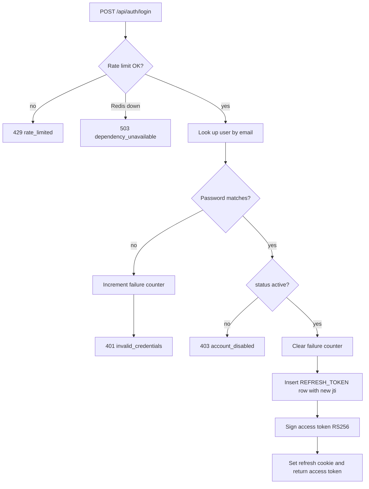

Unknown emails also increment the failure counter, so timing and rate limits do not reveal which emails exist. Both cases return the same `invalid_credentials` response.

### 5.2 Refresh with reuse detection

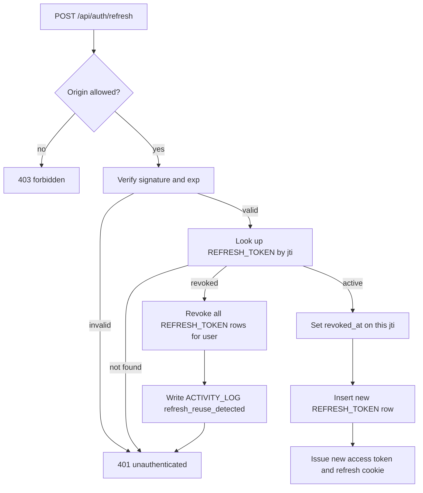

Reuse of a revoked token means someone has a copy of an old token. Revoking every session for that user forces a new login.

### 5.3 Password reset with recovery code

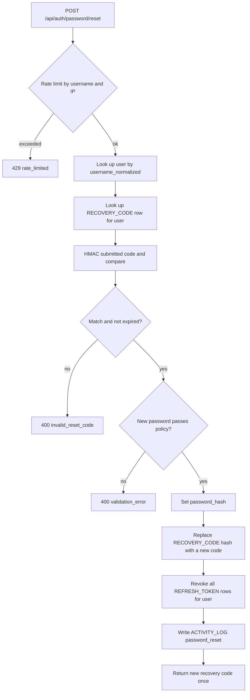

For an unknown username, the code comparison still runs against a dummy hash, so timing does not reveal whether the username exists.

### 5.4 Discussion write pipeline

Every write endpoint runs these steps in order.

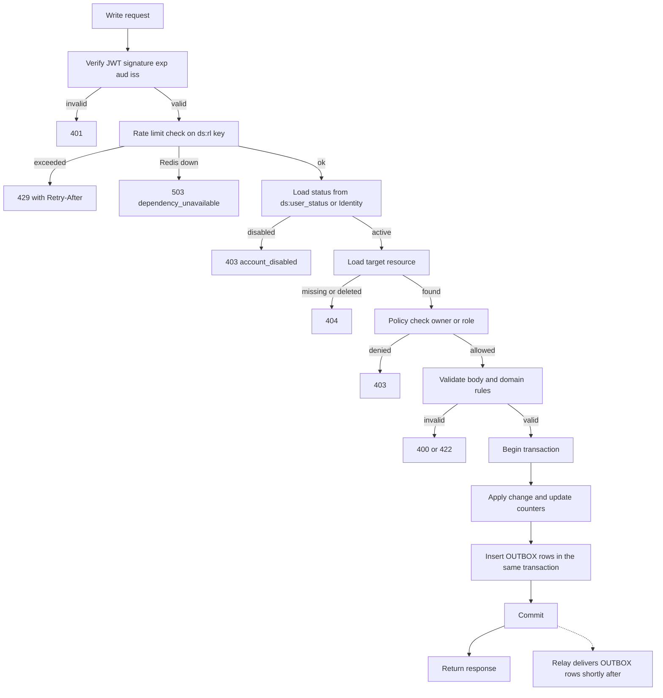

The response is returned after commit. Delivery to Redis happens later, through the relay in section 2.6. A Redis outage cannot cause a write to fail or an event to be lost.

### 5.5 Policy check

One function answers whether an actor may change a resource. Edits and deletes both use it.

```python
# domain/policy.py
def can_modify(actor, resource) -> bool:
    if actor.status != "active":
        return False
    if resource.deleted_at is not None:
        return False
    if actor.user_id == resource.author_id:
        return True
    return actor.role in ("moderator", "admin")
```

Owners can change their own content. Moderators and admins can change any thread or comment, including admin-authored content, as the HLD requires.

### 5.6 Thread list with cache

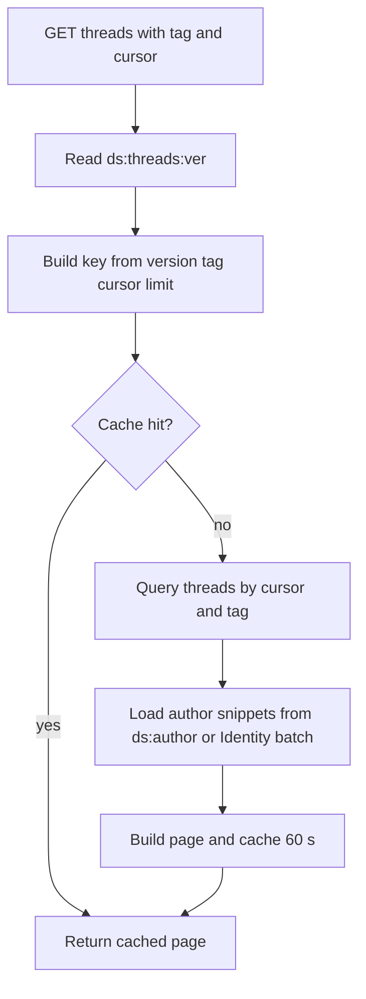

Any thread create, update, delete, or like change increments `ds:threads:ver`. Old list keys become unreachable and expire on their TTL. The version is one key, which is a hot key under heavy writes. Section 10 covers this.

If Identity is unavailable, the page is returned with `author.username` set to null, and the frontend shows "unavailable user". The page is not failed.

### 5.7 Like toggle

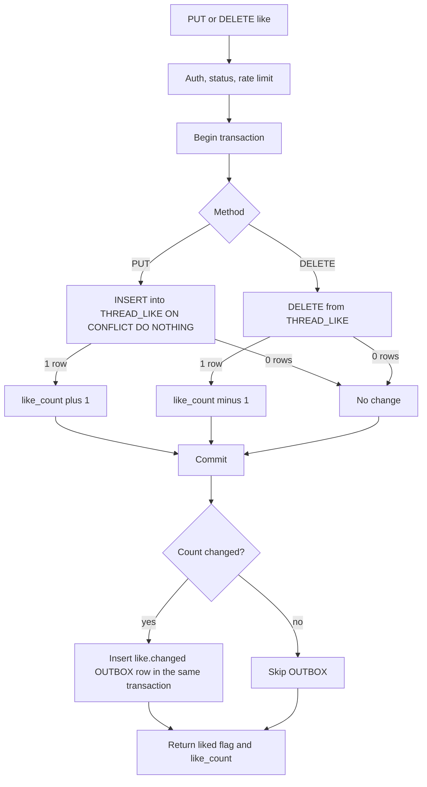

The counter changes only when the insert or delete affected a row, so repeated PUTs and DELETEs are safe.

### 5.8 Notify consumer

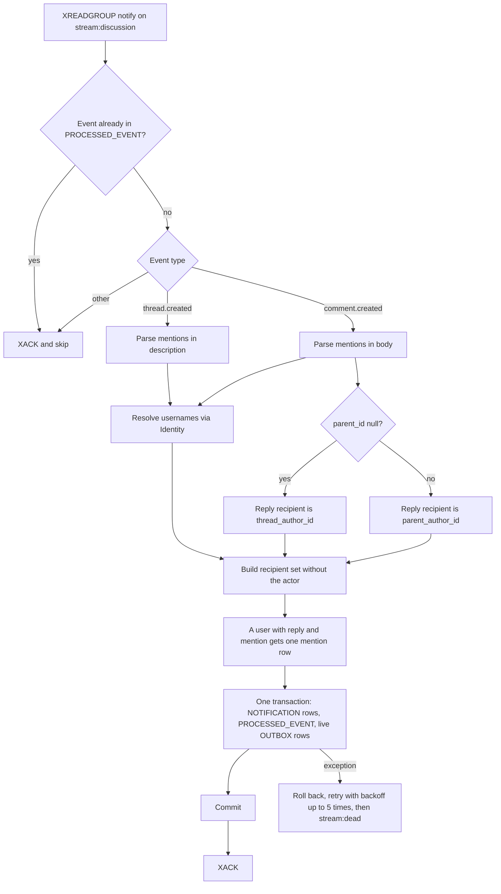

The mention parser matches `@` followed by a valid username, when the `@` is at the start of the body or follows whitespace. Email addresses are not mentions. Mentions inside code spans are ignored. A body can name at most 10 distinct users. Unknown usernames are dropped.

For `thread.created`, the author is excluded from mentions and no reply notification is created.

### 5.9 Search index sync

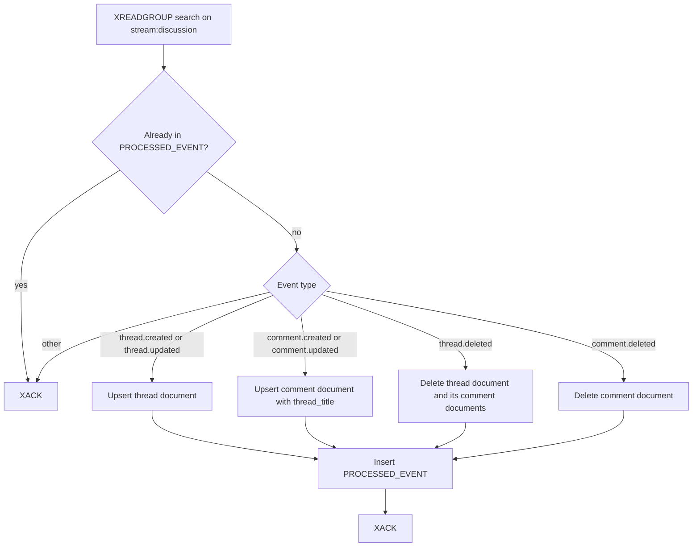

`thread.updated` also updates `thread_title` on that thread's comment documents, in one `UPDATE ... WHERE thread_id = ?`.

For `user.username_changed` on `stream:identity`, Search updates `author_username` on documents where `author_id` matches.

### 5.10 Realtime WebSocket session

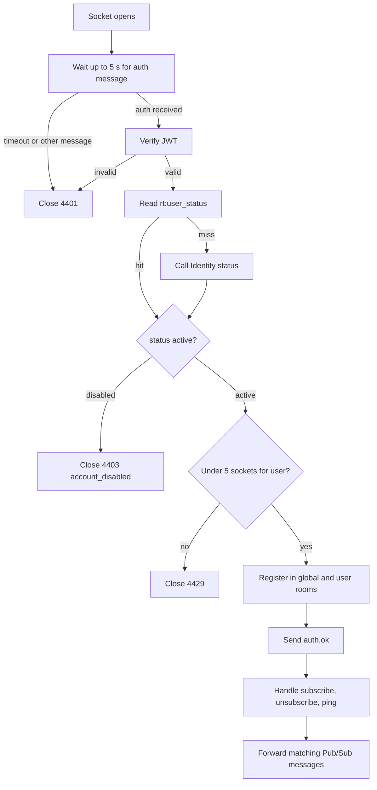

On disconnect, the socket is removed from every room it joined.

---

## 6. Data Flows

### 6.1 A write across services

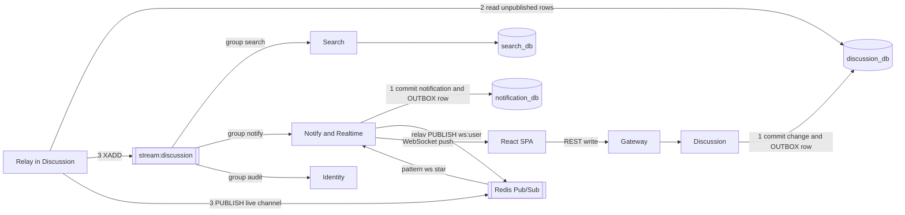

### 6.2 Identity change propagation

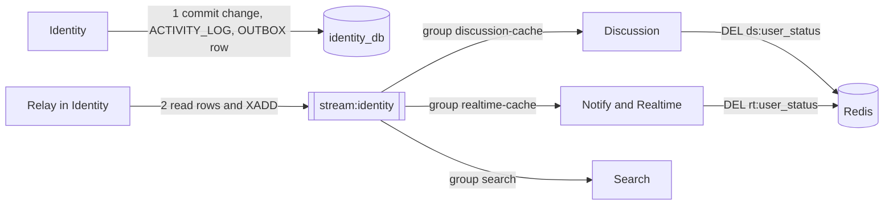

A 30-second TTL on status keys limits how long a stale entry can survive if an event is lost.

### 6.3 Read path with cache

Thread detail checks `ds:thread:{id}` first. A hit returns the cached document. `liked_by_me` is computed per request from `THREAD_LIKE`, so the cache key does not include the viewer. On a miss, Discussion loads the thread, caches it, and then adds the caller's like state.

Comment pages are not cached. Each page needs `liked_by_me` for the caller, so pages cannot be shared between viewers. One indexed query per page is acceptable at this scale.

### 6.4 Where each data copy lives

| Data | Source of truth | Copies | Freshness |
|---|---|---|---|
| Username, role, status | Identity | Discussion and Realtime status cache (30 s); JWT role claim (15 min); Search `author_username` | Event invalidation, TTL backstop |
| Thread and comment content | Discussion | Search documents | Event-driven, eventually consistent |
| Like counts | Discussion | Thread detail cache (60 s); Pub/Sub to browsers | Immediate to connected clients |
| Notifications | Notify and Realtime | Browser query cache | Live push plus refetch on reconnect |

---

## 7. Sequence Diagrams

### 7.1 Registration and login

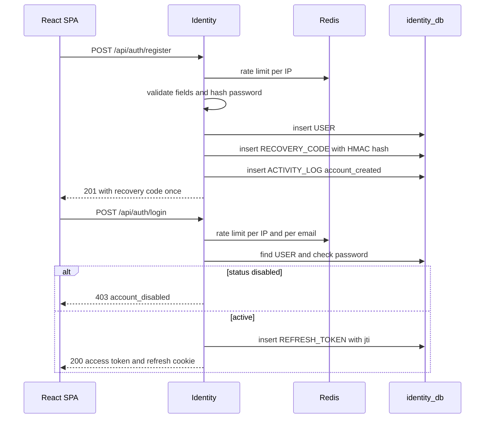

### 7.2 Refresh with rotation and reuse detection

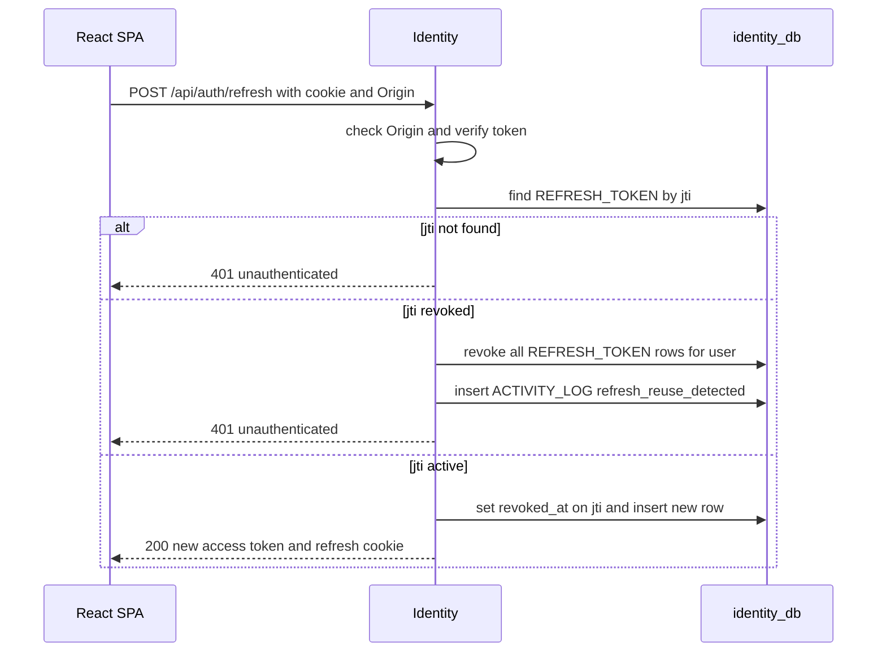

### 7.3 Password reset with recovery code

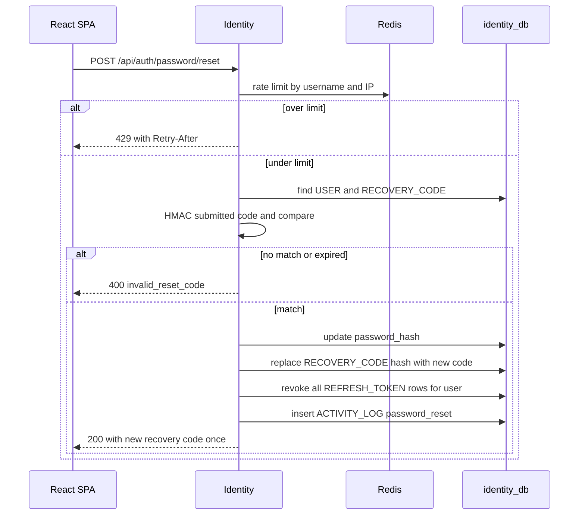

### 7.4 Create a thread

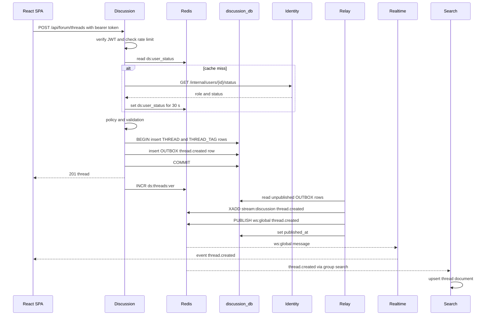

### 7.5 Reply with mention, notification, and live update

```mermaid
sequenceDiagram
    participant A as Ali browser
    participant DS as Discussion
    participant DB as discussion_db
    participant RL as Discussion relay
    participant R as Redis
    participant NR as Notify and Realtime
    participant ID as Identity
    participant NDB as notification_db
    participant NRL as Notify relay
    participant S as Sara browser
    participant SE as Search

    A->>DS: POST comment with parent_id and @sara_dev
    DS->>DB: BEGIN insert COMMENT depth 2 and update reply_count
    DS->>DB: insert OUTBOX comment.created row
    DS->>DB: COMMIT
    DS-->>A: 201 comment with mentions
    RL->>DB: read unpublished rows
    RL->>R: XADD stream:discussion comment.created
    RL->>R: PUBLISH ws:thread comment.created
    RL->>DB: set published_at
    R-->>NR: comment.created via group notify
    NR->>ID: POST /internal/users/resolve for sara_dev
    ID-->>NR: sara user id
    NR->>NDB: BEGIN insert reply row for Omar and mention row for Sara
    NR->>NDB: insert PROCESSED_EVENT and live OUTBOX rows
    NR->>NDB: COMMIT
    NR->>R: XACK
    NRL->>R: PUBLISH ws:user for Omar and Sara
    R-->>S: ws:user notification
    S->>S: show toast and update badge
    R-->>SE: comment.created via group search
    SE->>SE: upsert comment document
```

Omar gets a reply notification. Sara gets a mention. Ali is excluded because he is the actor.

### 7.6 Like a thread, idempotent, with live count

```mermaid
sequenceDiagram
    participant A as Ali browser
    participant DS as Discussion
    participant DB as discussion_db
    participant RL as Relay
    participant R as Redis
    participant O as Other browsers

    A->>DS: PUT /threads/{id}/like
    DS->>DB: BEGIN insert THREAD_LIKE ON CONFLICT DO NOTHING
    alt row inserted
        DS->>DB: increment like_count and insert OUTBOX like.changed
        DS->>DB: COMMIT
        DS->>R: DEL ds:thread
        DS-->>A: 200 liked true with new count
        RL->>R: PUBLISH ws:global like.changed
        R-->>O: like.changed to global sockets
    else already liked
        DS->>DB: COMMIT with no change
        DS-->>A: 200 liked true with same count
    end
```

### 7.7 Moderator edits another user's comment

```mermaid
sequenceDiagram
    participant M as Hala browser
    participant DS as Discussion
    participant R as Redis
    participant ID as Identity
    participant DB as discussion_db
    participant RL as Relay
    participant SE as Search

    M->>DS: PATCH /comments/{id} with new body
    DS->>DS: verify JWT
    DS->>R: read ds:user_status for Hala
    alt cache miss
        DS->>ID: GET /internal/users/{hala_id}/status
        ID-->>DS: role moderator status active
        DS->>R: set ds:user_status for 30 s
    end
    DS->>DB: BEGIN load COMMENT, check can_modify, update body
    DS->>DB: insert OUTBOX comment.updated and activity.recorded
    DS->>DB: COMMIT
    DS-->>M: 200 comment
    RL->>DB: read unpublished rows
    RL->>R: XADD comment.updated and activity.recorded
    RL->>DB: set published_at
    R-->>SE: comment.updated via group search
    R-->>ID: activity.recorded via group audit
    ID->>ID: write ACTIVITY_LOG comment_edited_by_moderator
```

### 7.8 Admin changes a role, demoted moderator blocked

```mermaid
sequenceDiagram
    participant Y as Yusuf admin
    participant ID as Identity
    participant DB as identity_db
    participant RL as Identity relay
    participant R as Redis
    participant DS as Discussion
    participant RT as Realtime
    participant H as Hala browser

    Y->>ID: PATCH /api/admin/users/{hala_id}/role
    ID->>DB: BEGIN update USER role, insert ACTIVITY_LOG role_changed
    ID->>DB: insert OUTBOX user.role_changed
    ID->>DB: COMMIT
    ID-->>Y: 200
    RL->>R: XADD stream:identity user.role_changed
    R-->>DS: user.role_changed via discussion-cache
    DS->>R: DEL ds:user_status
    R-->>RT: user.role_changed via realtime-cache
    RT->>R: DEL rt:user_status
    H->>DS: PATCH comment as moderator
    DS->>R: read ds:user_status (miss)
    DS->>ID: GET /internal/users/{hala_id}/status
    ID-->>DS: role member
    DS-->>H: 403 insufficient_role
```

The JWT can still claim `moderator` after the change. The status check uses the current role, so the next moderation request fails within milliseconds of the change.

### 7.9 Admin disables a user

```mermaid
sequenceDiagram
    participant Y as Yusuf admin
    participant ID as Identity
    participant DB as identity_db
    participant RL as Identity relay
    participant R as Redis
    participant DS as Discussion
    participant RT as Realtime

    Y->>ID: POST /api/admin/users/{id}/disable
    ID->>ID: reject if target is admin or self
    ID->>DB: BEGIN set USER status disabled
    ID->>DB: revoke all REFRESH_TOKEN rows for user
    ID->>DB: insert ACTIVITY_LOG user_disabled and OUTBOX user.disabled
    ID->>DB: COMMIT
    ID-->>Y: 200
    RL->>R: XADD stream:identity user.disabled
    R-->>DS: user.disabled invalidates cache
    R-->>RT: user.disabled closes that user's sockets with 4403
```

### 7.10 Search

```mermaid
sequenceDiagram
    participant UI as React SPA
    participant GW as Gateway
    participant SE as Search
    participant DB as search_db

    UI->>GW: GET /api/search?q=refresh+token&type=all
    GW->>SE: forward with bearer token
    SE->>SE: verify JWT and check rate limit
    SE->>SE: trim query and escape wildcard characters
    SE->>DB: SELECT from SEARCH_DOCUMENT where title, body or tags ILIKE pattern
    DB-->>SE: matching rows
    SE->>SE: build snippets around first match
    SE-->>GW: 200 items and next_cursor
    GW-->>UI: results
```

Search does not call Discussion or Identity during a request, so it keeps working when they are down, using its last indexed state.

### 7.11 WebSocket connect, subscribe, receive

```mermaid
sequenceDiagram
    participant UI as React SPA
    participant RT as Realtime
    participant R as Redis
    participant DS as Discussion

    UI->>RT: open wss /ws
    UI->>RT: auth message with token
    RT->>RT: verify JWT and check status
    RT-->>UI: auth.ok
    RT->>RT: join global and user rooms
    UI->>RT: subscribe to thread 6e4a2c8f
    RT->>RT: join thread room

    UI->>DS: POST comment on that thread
    DS->>R: PUBLISH ws:thread comment.created
    R-->>RT: pattern match ws star
    RT-->>UI: event comment.created
    UI->>UI: write comment into query cache
```

### 7.12 Report and moderator resolve

```mermaid
sequenceDiagram
    participant M as Sara browser
    participant HB as Hala browser
    participant DS as Discussion
    participant DB as discussion_db

    M->>DS: POST /api/forum/reports for a comment
    DS->>DB: insert REPORT
    alt duplicate reporter and target
        DS-->>M: 409 duplicate_report
    else created
        DS-->>M: 201 status open
    end
    HB->>DS: GET /api/forum/moderation/reports?status=open
    DS-->>HB: 200 queue
    HB->>DS: POST resolve with action delete_content
    DS->>DB: BEGIN set deleted_at on COMMENT, set REPORT resolved
    DS->>DB: insert OUTBOX comment.deleted and activity.recorded
    DS->>DB: COMMIT
    DS-->>HB: 200 status resolved
```

### 7.13 Redis unavailable

```mermaid
sequenceDiagram
    participant UI as React SPA
    participant ID as Identity
    participant DS as Discussion
    participant R as Redis

    UI->>ID: POST /api/auth/login
    ID->>R: rate limit check
    R--xID: connection error
    ID-->>UI: 503 dependency_unavailable

    UI->>DS: GET /api/forum/threads
    DS->>R: read cache
    R--xDS: connection error
    DS->>DS: query database without caching
    DS-->>UI: 200 page
```

Auth endpoints fail closed. Read endpoints skip the cache and continue. Write endpoints that depend on rate limits fail closed. Redis failures never fail a committed write: events wait in OUTBOX until Redis returns, as described in 2.6.

---

## 8. Permission Matrix

| Action | Member (own content) | Member (others) | Moderator | Admin | Enforced in |
|---|---|---|---|---|---|
| Create thread or comment | yes | yes | yes | yes | Discussion |
| Edit thread or comment | yes | no | yes (any) | yes (any) | Discussion, `can_modify` |
| Delete thread or comment | yes | no | yes (any) | yes (any) | Discussion, `can_modify` |
| Like or unlike | yes | yes | yes | yes | Discussion |
| Report content | yes | yes | yes | yes | Discussion |
| View report queue | no | no | yes | yes | Discussion |
| Resolve or dismiss report | no | no | yes | yes | Discussion |
| Remove tag from threads | no | no | no | yes | Discussion |
| View activity log | no | no | forum actions only | all | Identity |
| Change role | no | no | no | yes (not self) | Identity |
| Disable or enable account | no | no | no | yes (not admins, not self) | Identity |
| Issue recovery code for a user | no | no | no | yes | Identity |
| Update own profile, username, avatar | yes | no | yes | yes | Identity |
| View own notifications | yes | yes | yes | yes | Notify and Realtime |
| Search threads and comments | yes | yes | yes | yes | Search |

A disabled user is blocked at login, refresh, and every write through the status check. Public reads remain available to them only if the frontend allows it; the backend treats disabled accounts as unable to call any authenticated endpoint.

---

## 9. How Each Service Works

### 9.1 Identity

Identity is a Django project with several apps. The two that define the forum's accounts are `accounts` and `auth_flow`.

`accounts` contains the custom user model. Its fields are described in 3.1. Profile updates write to `USER` and then to `ACTIVITY_LOG` only when the username changes, so the 30-day rule can be checked against the log.

`auth_flow` handles registration, login, refresh, logout, and reset. Registration creates the user, creates a `RECOVERY_CODE` row, writes an activity entry, and returns the code once. The frontend must show the code with a copy action and a confirmation step, because the database holds only its hash.

Login issues a 15-minute RS256 access token and a 7-day refresh token. The refresh token's `jti` is stored in `REFRESH_TOKEN`, and refresh rotates it. Reuse of a revoked `jti` revokes all of that user's sessions.

Admin actions run through the admin API or Django Admin. Each one changes the user row, inserts an `ACTIVITY_LOG` entry, and inserts an OUTBOX row, all in one transaction. The relay then delivers the event to `stream:identity`. Identity also runs `manage.py consume_events`, which writes `activity.recorded` events from other services to `ACTIVITY_LOG` (section 2.6). Identity never serves cached status; it is the source other services fall back to.

Internal endpoints return public fields and status only. Email addresses are never returned to other services.

### 9.2 Discussion

Discussion owns the forum model. Routers in `api/` call domain functions in `domain/` through FastAPI dependencies that run JWT verification, rate limiting, and status checks in the order shown in 5.4.

Thread creation normalizes tags, inserts the thread, links tags through `THREAD_TAG`, and commits. Tags are created on first use with `INSERT ... ON CONFLICT DO NOTHING`. In the same transaction it inserts a `thread.created` OUTBOX row for the stream and the global live channel. After commit it increments the list version key.

Comment creation computes depth and continuation as in 4.4, inserts the row, increments `reply_count` on the parent and `comment_count` on the thread, and commits. Its OUTBOX rows carry `comment.created` for the stream and a live message for the thread's channel.

Edits and deletes call `can_modify`. Soft deletes set `deleted_at` and decrement counters only if the item was not already deleted. Moderator and admin actions also insert an `activity.recorded` OUTBOX row, which Identity stores in `ACTIVITY_LOG`.

Reports insert a `REPORT` row. Resolving with `delete_content` runs the same soft-delete path as a direct moderator delete, so the behavior and audit trail are identical.

Discussion stores no user profile data. Author fields come from Identity's batch endpoint and are cached briefly.

### 9.3 Notification and Realtime

This service runs two halves in one process. The notify half reads the stream and writes notifications. The realtime half accepts sockets and forwards Pub/Sub messages.

The notify half parses mentions and reply targets as in 5.8. It resolves usernames through Identity, caching results in memory for 60 seconds, and inserts one row per recipient. The unique constraint on `(recipient_id, source_event_id)` makes redelivery harmless. The notification rows, the `PROCESSED_EVENT` row, and the live OUTBOX rows commit together, and the stream entry is acknowledged only after that commit.

The realtime half holds a local registry: user ID to sockets, thread ID to sockets, and the global set. Pub/Sub messages carry a target (`global`, `thread:{id}`, or `user:{id}`) and a JSON event. The dispatcher sends the event to each socket in the matching set.

Each instance has its own registry, and every instance receives every Pub/Sub message, so no instance needs to know about the others.

The inbox reads `NOTIFICATION` directly. The unread count is a count over `(recipient_id, read_at)`, which is fast at Phase 1 volumes.

### 9.4 Search

Search has a single write path, the consumer, and a single read path, the search endpoint.

The consumer groups entries, checks `PROCESSED_EVENT`, and applies the changes in 5.9. Each event maps to one of four operations: upsert thread, upsert comment, delete a thread with its comments, or delete a comment.

The query builds a parameterized `ILIKE` statement on `title`, `body`, and `tags`, applies the type and tag filters, and returns the newest 20 rows with a cursor. Snippets are taken from the first match in `body`, with 80 characters of context on each side.

Phase 2 adds an embedding column and a second ranking pass. The change is additive, so the upsert key stays the same.

### 9.5 Frontend

There are three dashboards, for members, moderators, and admins. The layout reads the role from the decoded token to choose which navigation items appear. If the server rejects an action with `insufficient_role`, the UI shows a message and refetches the profile, so stale role controls correct themselves.

The WebSocket hook connects after login, authenticates with the token, subscribes to the open thread, and applies each event to the TanStack Query cache. A `thread.created` event prepends to the list. A `comment.created` event inserts into the loaded replies of its parent, or increments the parent's reply count when those replies are not loaded.

On close, the hook reconnects with exponential backoff capped at 30 seconds and refetches active queries.

---

## 10. Known Gaps and Decisions to Confirm

Resolved in this version. Events are no longer lost when Redis is down or a process crashes after a commit, because every event is written to an OUTBOX row in the same transaction. Three limits remain. Relay latency is usually under a second and grows during a Redis outage. Redis must run with append-only persistence enabled, so acknowledged stream entries survive a restart. A consumer that falls behind the stream's `MAXLEN` cannot replay what it missed, so Search rebuilds from Discussion's internal export when that happens.

The thread list version key is a single hot key. This is fine at course scale. A larger deployment would use per-tag version keys.

The 30-second status cache allows a disabled user a short window to write if the invalidation event is delayed. The HLD accepts this, and the negative tests in section 12 cover it.

Search keeps content from disabled users indexed and visible, which matches the HLD suspension rule. This supersedes the older HLD Section 7 wording that hid such content from ordinary members.

The author snapshot cache means a username change can take up to 60 seconds to appear on thread pages. Search updates from events, so search results change faster. This is acceptable.

Recovery codes use HMAC-SHA256 with a server key, not Django's password hasher, because the codes are high entropy and lookups must be fast. Rotating the server key requires re-issuing active codes.

Activity events from Discussion now travel through the outbox, so a moderation action is recorded once its transaction commits. Delivery is at least once, and Identity's audit consumer deduplicates on `event_id`. Tamper-evident audit remains out of scope.

---

## 11. Configuration Reference

| Variable | Service | Purpose |
|---|---|---|
| `JWT_PRIVATE_KEY_PATH` | Identity | RS256 signing key, mounted as a secret file |
| `JWT_ISSUER` | Identity, all FastAPI services | Expected `iss` claim, default `identity` |
| `JWT_AUDIENCE` | Identity, all FastAPI services | Expected `aud` claim, default `forum` |
| `JWT_PUBLIC_KEY_PATH` | Discussion, Notify and Realtime, Search | RS256 verification key, read-only mount |
| `RECOVERY_CODE_HMAC_KEY` | Identity | HMAC key for recovery codes |
| `SERVICE_API_KEYS` | Identity | Map of calling service to key |
| `IDENTITY_BASE_URL` | Discussion, Notify and Realtime, Search | Internal base URL |
| `REDIS_URL` | all | Connection string |
| `DATABASE_URL` | each service | Its own database only |
| `CORS_ALLOWED_ORIGINS` | Identity, Discussion, Search | Browser allow-list |
| `ACCESS_TOKEN_TTL_SECONDS` | Identity | Default 900 |
| `REFRESH_TOKEN_TTL_DAYS` | Identity | Default 7 |
| `STATUS_CACHE_TTL_SECONDS` | Discussion, Notify and Realtime | Default 30 |
| `OUTBOX_RELAY_INTERVAL_MS` | Identity, Discussion, Notify and Realtime | Relay polling interval, default 200 |
| `OUTBOX_BATCH_SIZE` | Identity, Discussion, Notify and Realtime | Rows per relay batch, default 100 |
| `OUTBOX_RETENTION_DAYS` | Identity, Discussion, Notify and Realtime | Published rows kept before deletion, default 7 |
| `TRUSTED_PROXY_IPS` | Identity, Discussion, Search | Gateway addresses whose `X-Forwarded-For` is accepted |
| `WS_MAX_SOCKETS_PER_USER` | Notify and Realtime | Default 5 |

All values come from the environment. `.env.example` lists every name with a placeholder. No secret is committed.

---

## 12. Testing Map

| HLD level | LLD coverage |
|---|---|
| Unit | `can_modify` truth table (role by ownership by deleted state). Depth and continuation at depths 1, 5, and 6. Mention parser: email addresses, code spans, more than 10 mentions, unknown names. Username and tag validation. Recovery code HMAC and constant-time compare. ILIKE escaping. Rate-limit script. |
| API | Every endpoint in section 4 with success, 400, 401, 403, 404, 409, and 429 cases. Disabled user blocked at login, refresh, and writes. Reused refresh token revokes all sessions. Recovery code cannot be reused after reset. Duplicate like returns 200 with unchanged count. Duplicate report returns 409. |
| Integration | Stream and Pub/Sub publish after each write type. Notify creates exactly one row per recipient on duplicate delivery. Search upserts and deletes match events. Role change invalidates Discussion and Realtime caches. Entries move to `stream:dead` after five failures. |
| WebSocket | Missing auth closes with 4401. Disabled user closes with 4403. Sixth socket closes with 4429. Subscribe and unsubscribe filter events. Pub/Sub reaches sockets on a second instance. Reconnect triggers a refetch. |
| Outbox | Row rolls back with its change when the transaction fails. Relay replays unpublished rows after Redis returns. Relay restart after `XADD` but before marking published produces a duplicate that consumers ignore. Only one relay runs per service. Published rows older than the retention window are deleted. Oldest-unpublished alert fires after 60 seconds. |
| Security | Expired token, wrong `iss`, wrong `aud`, `HS256` or `none` algorithm, and tampered signature each return 401. Login stores a bcrypt hash. Refresh cookie has `HttpOnly`, `Secure`, and `SameSite=Strict`. A socket never receives another user's `ws:user` message. |
| Negative | Redis down on login (503), on reads (cache skipped, 200), and on rate-limited writes (503). Stream write failure after commit (201, logged). Consumer crash mid-batch (entries reclaimed with XAUTOCLAIM, processed once). |

---

## 13. Security Implementation

The rules come from HLD section 6. This table shows how each rule is implemented and where it is enforced.

| Rule | Implementation | Enforced in |
|---|---|---|
| Passwords hashed with bcrypt | Django `PASSWORD_HASHERS` lists `BCryptSHA256PasswordHasher` first. Older hashes are upgraded at next login. | Identity |
| Recovery codes hashed with HMAC-SHA256 | HMAC with `RECOVERY_CODE_HMAC_KEY`, compared in constant time | Identity |
| Access token signed with RS256, 15 minutes | Claims `iss` (`JWT_ISSUER`), `aud` (`JWT_AUDIENCE`), and `exp` set to `iat + 900`. Only Identity signs. | Identity |
| Token validation | Verify with `algorithms=["RS256"]` (rejects `none` and `HS256`), then check signature, `iss`, `aud`, and `exp`. Failures return 401. | Every service |
| Refresh cookie | `HttpOnly; Secure; SameSite=Strict; Path=/api/auth`. `Origin` checked on refresh. Revoked on logout, reset, and reuse. | Identity |
| Keys and secrets | Private key mounted only into Identity. Public key read-only elsewhere. Values come from environment or secret files. `.env` is git-ignored. `.env.example` holds placeholders only. | Deployment |
| Role and status freshness | JWT role used for ordinary reads and writes. Moderation and admin actions check Identity status, cached for 30 seconds. `user.role_changed` and `user.disabled` events clear the cache. No role claim is trusted beyond 15 minutes. | Discussion, Notify and Realtime |
| Per-service permissions | `can_modify` policy and role guards on each route. The frontend hides controls but is never the boundary. | Discussion, Identity |
| WebSocket authentication | Token sent in the first message within 5 seconds. Otherwise close with 4401. Token never appears in the URL. | Notify and Realtime |
| Private notifications | Sent only to the `user:{id}` room. Pub/Sub channel `ws:user:{id}` is delivered only to that user's sockets. | Notify and Realtime |
| Disabled users | Blocked at login, refresh, and writes. Open sockets closed with 4403. | Identity, Discussion, Notify and Realtime |
| Input and queries | Pydantic and DRF validation. Parameterized queries only. `ILIKE` input escaped. | All services |
| Text output | Stored as plain text. React escapes on render. No HTML rendering. | Frontend |
| Avatar URL | Must start with `https://`, at most 2048 characters. Never fetched. | Identity |
| Rate limits | Redis counters keyed by IP, user, or username | Identity, Discussion, Search |
| Service-to-service calls | `X-Service-Key` header, one key per calling service, checked on `/internal/*` | Identity |
| Client IP | `X-Forwarded-For` accepted only from `TRUSTED_PROXY_IPS` | Identity, Discussion, Search |
